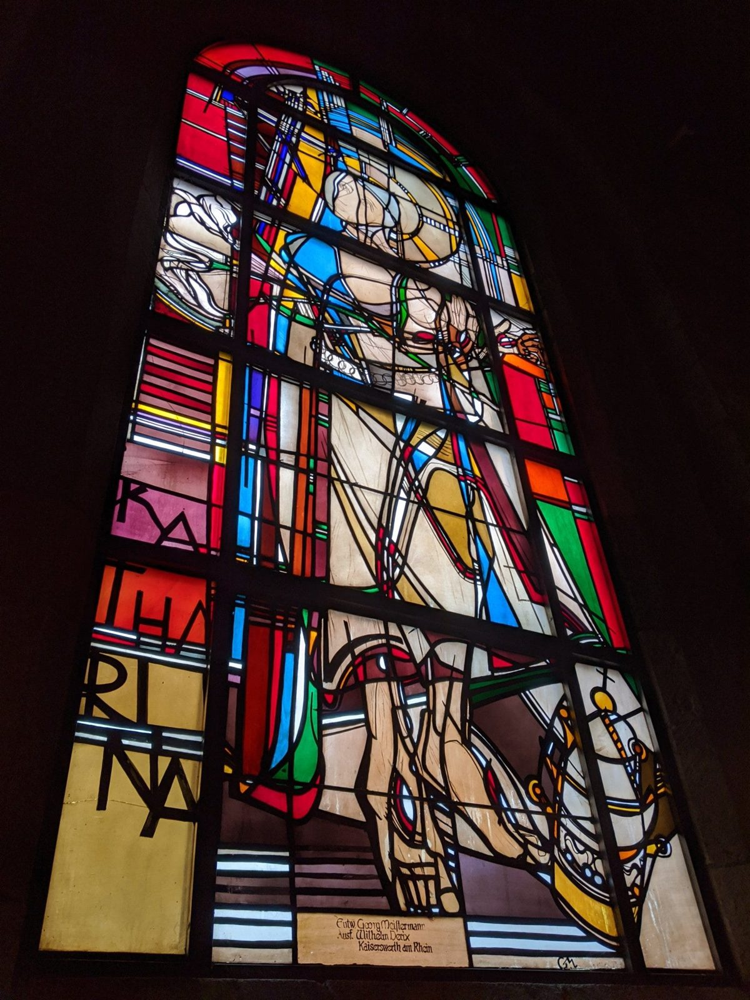

* * *

The stained glass window of my heart
Was bound with leaded poison
I plumbed the depths and they plumbed me
And now to set it free, my love
And now to set it free.

* * *

Did we break what we created?
Will I turn away from you?
Will you become a former?
Will my heart be healed or stay a lump?
Will we rise to the occasion?
Will you find your way and I'll know someday
That you will never kill me?

* * *

My children need a model, love
We need a man to look to
We have their dad and I'm so glad,
But you were love to show them.
You were the love to show them.

* * *

Can I imagine, now that we know
That you destroyed their picture
With far flung rage and built a cage
Out of the house I gave them
Out of the nest I made
That you are love to show them?

* * *

*201703*
