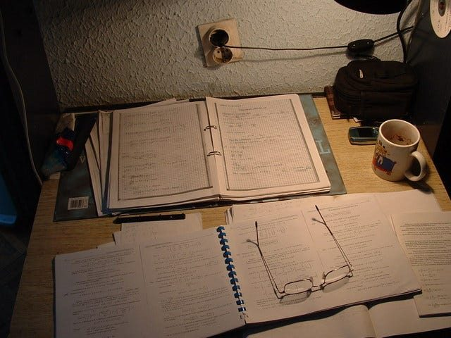

* * *

She’s trying to understand the
Meaning that underlies
An observation
Her scribbles strive to account for all
Known variables in a partial equation,
The page is filled with symbols
Numbered assumptions
Annotated below
Her eyes flicker as she attempts
To express the patterns
In their simplest form
Her confident hand
Smoothes the variance,
Defines the surreal
The peaks
Their depressions
The outliers and aggregates
And, as she calculates, the pages fill
Averaging results
To give approximations that
Allows vectors to be drawn
And waves to form
Into a decipherable
Model of asymptotic

Imperfection
