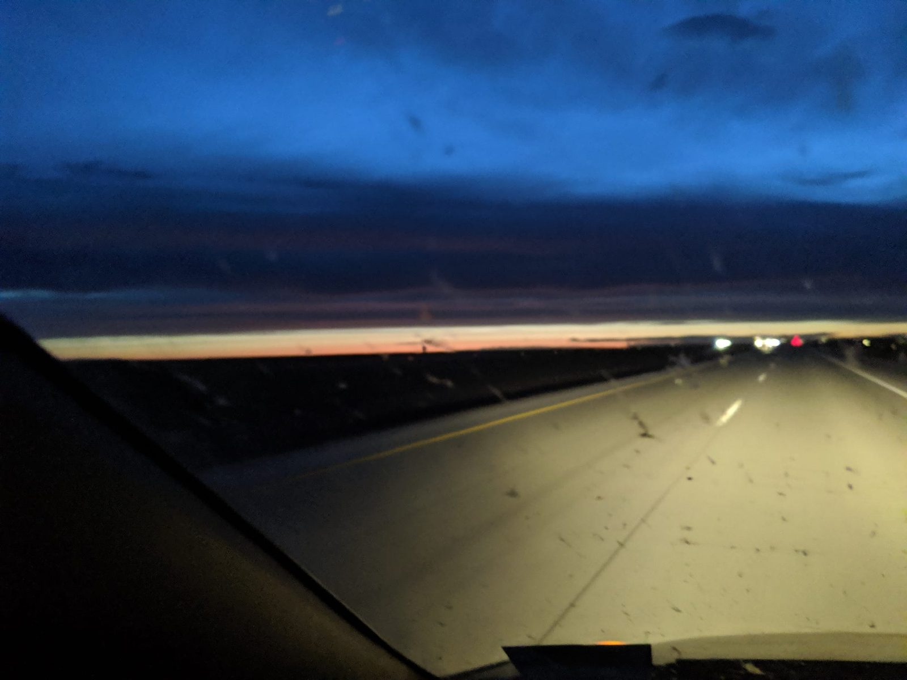
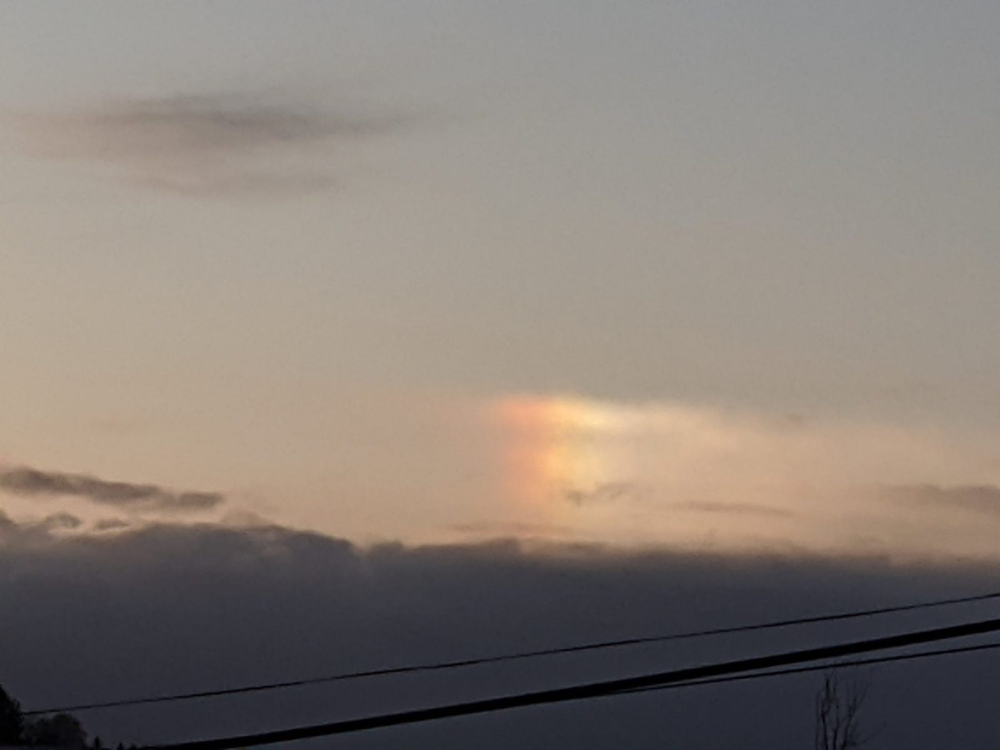

* * *

Driving on the road
From Salt Lake to Boise
Along the Oregon Trail
Appeared three, count them!
Phantastipheric formations
In a singular hour

* * *

A square rainbow
Floating shy and lonely
A pale wallflower
Hanging there glistening
Dressed in a wispy cloud
Straight ahead and up

* * *

And later, as the sun set
Appeared the brightest
Neon pink parallelogram
A wide boxed-in ray of light
Framed sharp and bold
Like eyeshadow
On an 80s rock star
Through the windshield

* * *

And, as the sun fell below the earth
A creamy glowing lake of sky
Appeared off to our left
Whether air or sea
Clouds lapping at the shore
And in between dark fluffy islands

* * *

How I’d love to row out
Take a deep dive,
Float buoyed treading
And swim to see
The luminescent coral
I know must lie below

* * *

I cried out in awe
Each time more bombastic
My children looked up
From the stories
That absorbed them
Of magic and power

* * *

Held within humanity's dreams
On the wireless web
While I raved and giddied
They smiled bemused
At their mother
And continued along
The Way

* * *

*06/2019*
*No pictures will ever do it justice.*

