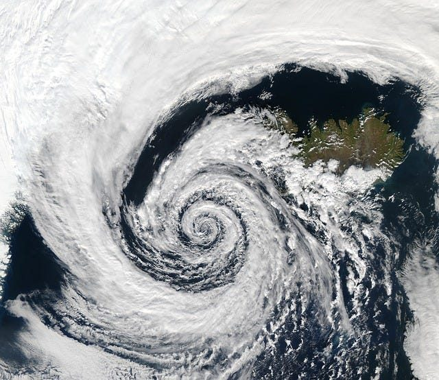

* * *

Buffeted by the waves in the atmosphere
Flooded by the water of life
Battered by it’s hurricane-force winds
Broken by the singularity of its power

And killed by it’s detritus
Fears for herself, her produce, washed away
Her work, her love, in a swirling flash
Her little farm and fam

We’re lost in the hurricane
All is lost
All is lost to the fickle sea and the
Doubt that flickers in the fire at night

It burns up everything in sight
Rages across the mindful eye
And crosses boundaries, it crests
Roaring uncontained

Oh the Humanity!

I don’t know what I felt I knew
I don’t believe what I thought was true
I don’t feel what I used to feel, convict
About the world… and me… and you

Others come and then they go
Lost and left for dead they go
Moving on through time gone by
A greasy trail of memory

* * *

Jōb, I am not, by a very long shot
I never was, and never will be
So good at faith outside of me
For I am one of the fallen.
