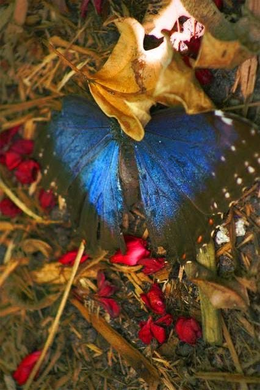

* * *

Between Gossamer and Sunshine
A fallen leaf rises
As the garage door opens

Hanging

Stuck and tangled in spider webs
Blowing in the breeze

Glistening in the morning light
Walking outside, noticing

Smile

Press the button.
Close the door.
Drive away.

* * *

*for Scott*
