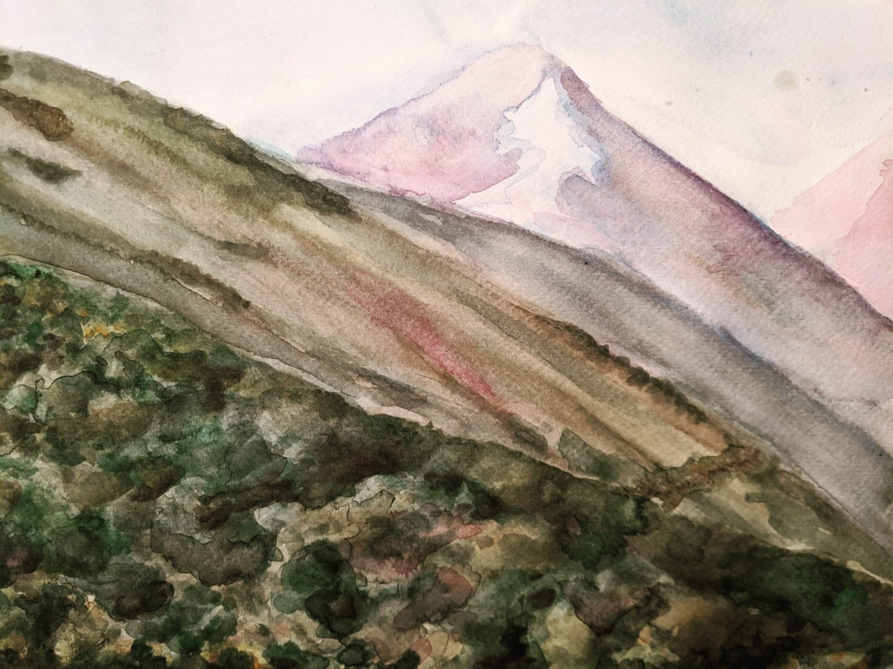

* * *

Listening to the stream flow
Looking at the stars
The crescent moon
Silhouettes the mountains

* * *

Aspen and pine trees
Scent the air
Look!
There! A shooting star!

* * *

Morning
Sky so blue
A hummingbird, a Steller’s Jay
Hopping atop the trees

* * *

The mountains are purple today
And the sound of machinery
Whirrs at my ears
Behind the winding silence

* * *

*08/2018*
