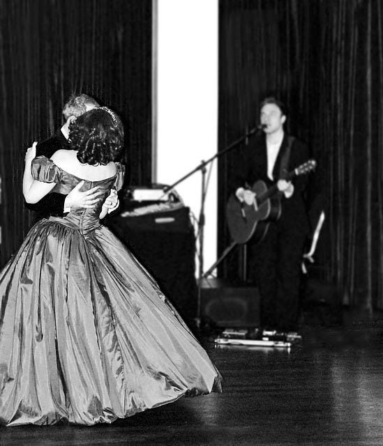

* * *

…………….

It’s the same ol’
Song an’ Dance

It’s the long-pull
Final last chance

It’s the way we sip
Our drinks

It’s the love that
Makes us sink <<<or swim>>>

Or the way we look
Each other
In the eye

It’s the same ol’
Song an’ Dance

It’s the pain that
Frees our trance

It’s the lightness
In our step

Or the destruction
Of our rep

It’s the same ol’
Song an’ Dance

It’s the long-pull
Final last chance

…………….
