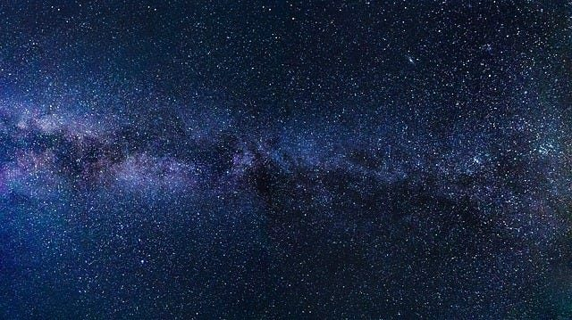

*[https://pixabay.com/en/users/FelixMittermeier-4397258/](https://pixabay.com/en/users/FelixMittermeier-4397258/)*

* * *

slowly jetting
down the sta(\*)rs
(i) burn
inside

* * *

these dark-end

desolate

spaces

\*
(\*) hold

\*\*\*

for you

\*\*\*\*\*

* * *

\*\*\*\*\*\*\*
emptiful

\*\*\*\*\*\*\*\*\*

* * *

the love i hope for
traveling
the outer reaches
the love (i) feel
in these depths

* * *

this event horizon
is stretched
wide
in orbit
around your arms

* * *

it makes me want
to kiss
every one \*
of the stars \*
in your eyes \* \*
\*\*\*\*\*\*\*\*\*\*\*\*\*\*\*
