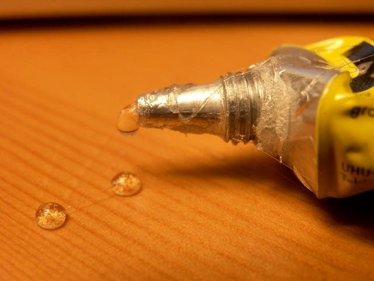

*[https://www.freeimages.com/photographer/bananaism-48053](https://www.freeimages.com/photographer/bananaism-48053)*

* * *

Attach hard to the people you love.
To those that love you.
Like gum on a shoe. Like epoxy, heating up.
Make a chemical bond.
Like a soda spilled on a wooden floor
Every time you walk by you feel the stick-stick.
Remember to clean up after yourself.
And the next day find more.
Let them be like an old sticker that can’t be peeled off,
That rips and tears and leaves a lot of gunk.
You know the ones.
Something that can’t be peeled in one piece
Let them leave a stain that no one can remove.
Something that when touched
Leaves a black mark between the fingers
Still there years later.
And if they say “Go!”
Listen. Hard.
Let them leave their residue on you.

* * *

This poem reveals a mindset that can be exploited and used by abusers.
