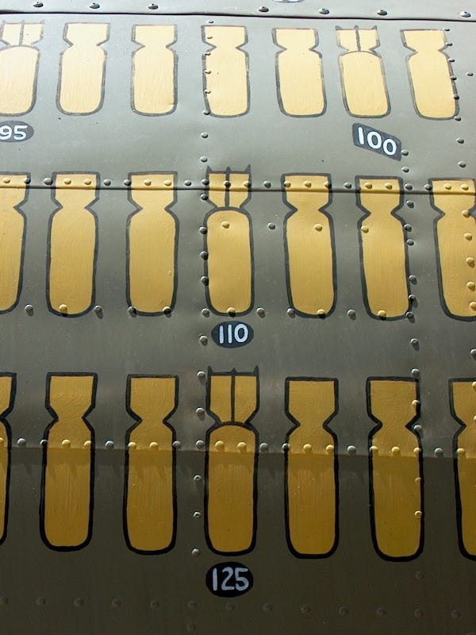

* * *

There I go, opening my mouth again

I imagine I’m a B-52
Dropping bombs with every word
So afire I can’t speak straight

I tried listening, clarifying
Tried talking, negotiation
About what’s bothering me

Treaties and escalation
Asking for help from neutral players
Negotiations have failed

The sounds are bullets across the hull
What I’m doing isn’t working
Starting to cycle in on myself

Declaring war
Feeling nuclear and yelling nonsense
Defending my boundaries

When the bombs drop
It ends up hurting more
I fly away

And crash and burn
