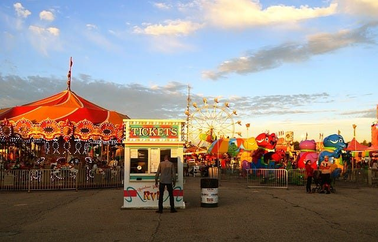

* * *

Come one, come all…

Step right this way

To see the greatest show.

Amazing things will happen

We promise you fo’ sho’

Darkness and betrayal

Blood and lust besides

The heights of Heaven, the gates of Hell

There’s something here for everyone

Just walk right up and in that door

Bring your husbands

Bring your wives

The princess and the diva

Bring the racist fucks and

The school marm in her shawl

Hey! Don’t forget your pussy grabbers

Bring them one and all

We’ll show you lights

We’ll show you action

We’ll show you girls and boys

And other things

With pronouns that

You can’t begin to ‘spise

There’s freaks and geeks to gawk at

Homeless and the lost

Come in. Come in. And see the show.

Your coin will trump the lot.
