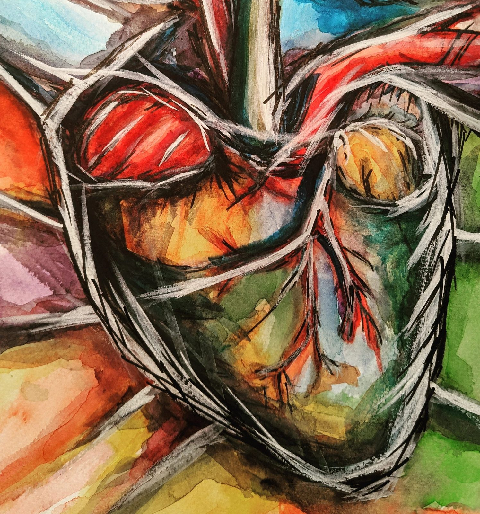
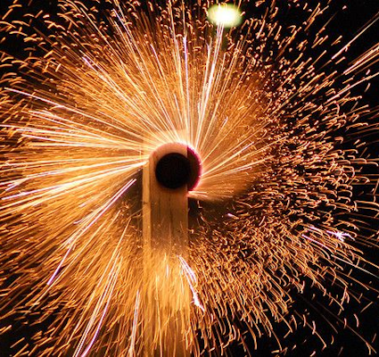

*Watercolor by JD Carlston*

* * *

the seed of another kind of awareness
snaked through my veins
moved into my heart
welcomed Home
buzzed about like a housewife making herself comfortable
the stained glass windows lit up
from the inside
the stem cells seeped into each corner
each crevasse as it stretched and grew
brighter on the inside
rainbows flew out
their hooks got caught into you
as you saw yourself reflected
looking within with awe
looking back in time with reverence
a prismatic chandelier
blowing in the wind
a tree rooted firm on top of a cliff
a cradle in its boughs
a pillar of smoke
a pillar of fire
the cosmic egg
how beautiful we are!
a reference to the other self within
the meaning-making machines
and my heart, dear heart
it began to sing
to hum with ever-new life
an embryonic lighthouse
that pulls energy from the Catherine Wheel that now spins in our core
a true solar plexus manifesting generator
turning “I don’t have what I need"
into something new
Something free
Something empty
And full of power
into “I can **Be** in need”
with a living-breathing alchemy
lining the cracks
linking the stained glass
rainbow bonds with gold instead of lead
with Generations of self-others
Mitochondrial Mothers
Family and Land
Values and Experiences
Color and Light
Song and Dance
Revised and Recorded
Connectors to the multi-universal contextualizing data -≥ information -> knowledge -> wisdom -> flow
by the healing we provide one another

*Catherine Wheel*

* * *

*07012023*
Learning and insights that informed this poem were assisted through techniques and interactions developed by:

- [Carolyn Elliott](https://carolyngraceelliott.com/)
- [Holly Hamel](https://holly-hamel.com/)
- [Leslie Quigless](https://www.inquirymeditation.com/)
