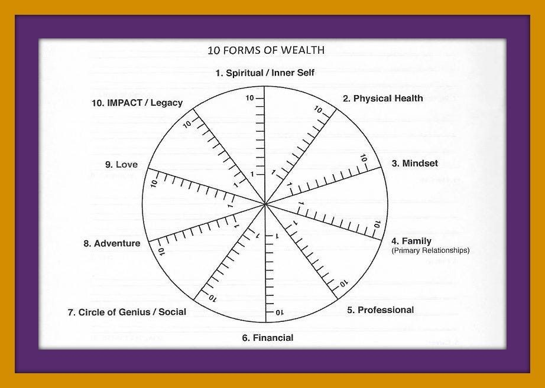
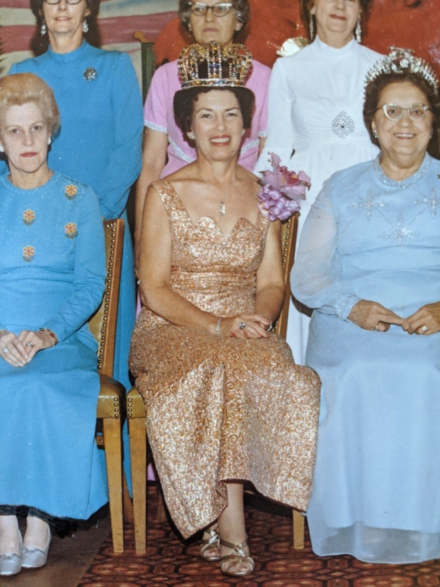
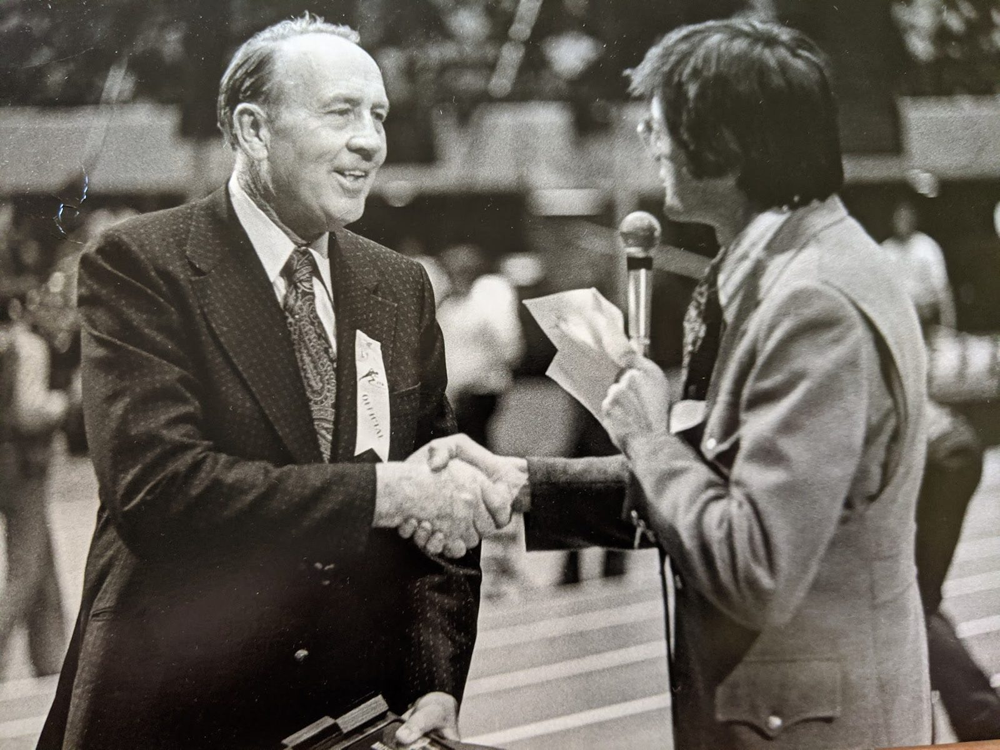
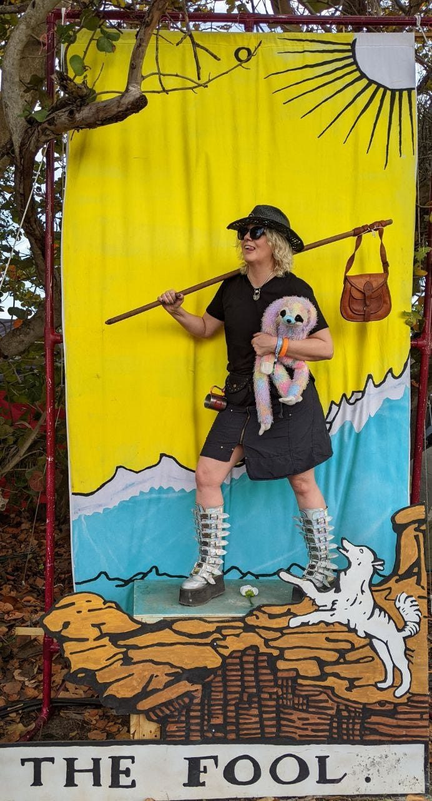
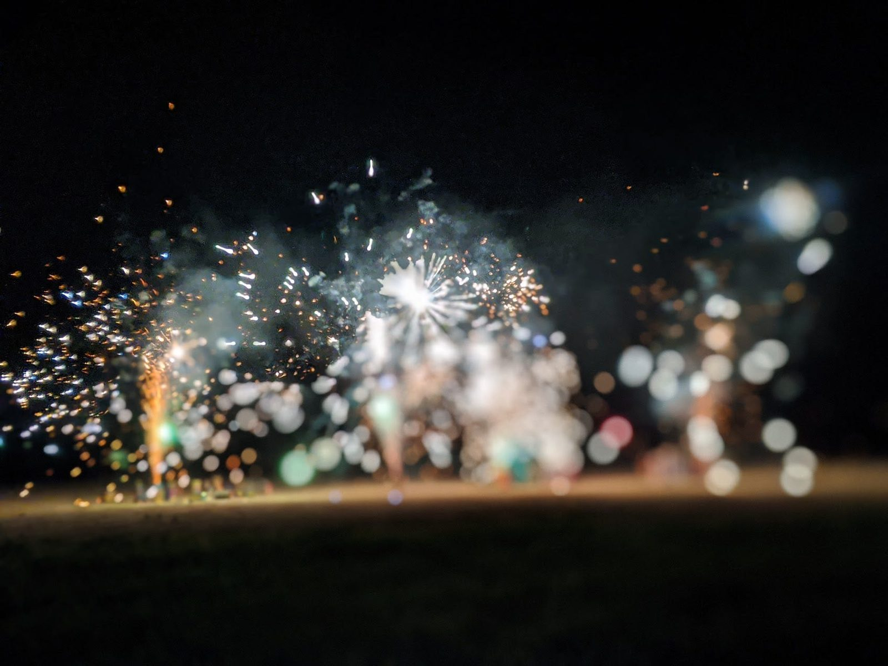

*h[ttps://positivepsychology.com/wheel-of-life-coaching/](https://positivepsychology.com/wheel-of-life-coaching/)*

## On Being Healthy, Wealthy, Compassionate, & Wise

I would like to have the deepest well, a limitless well, of wealth in all its forms.
Let me be as rich in experience and spiritual depth as my ancestors and progeny could imagine or wish.
Let me use my wealth to increase play and reduce suffering within our existence.

* * *

Part of what caused me to take a leap and join a mystery school was to explore my kinetic and potential energy and to build a greater store of personal and professional wealth. When I say wealth I’m not generally talking about money.

My grandparents were the richest people I knew. They were not, nor would they have ever been, featured on Lifestyles of the Rich and Famous. That’s not the kind of wealth I’m talking about. Their lives were well-balanced. They knew themselves and knew what they wanted from life. They knew their own power and they worked together effectively — professionally, personally, spiritually.

Growing up watching them, they embodied true wealth to me.

They sought education, they were physically and socially active. They worked hard to make the world a better place for children and their parents. They volunteered and they traveled around the world helping others. They learned. They played hard and loved deeply. They were compassionate and gentle, and they contained a force of will that I am still in awe of when I remember them today. They left a legacy that impacted thousands upon thousands of people’s lives.

* * *

[Pete Carlston - WikipediaFrom Wikipedia, the free encyclopedia Peter LeRoy Carlston (February 3, 1911 - April 27, 1992) was an American…en.wikipedia.org](https://en.wikipedia.org/wiki/Pete_Carlston)

[Eleanor Jane Heitzman Carlston - Starks Funeral ParlorEleanor Jane was born in her Grandmother's house in Denver, Colorado because the hospital was full of victims of the…www.starksfuneral.com](https://www.starksfuneral.com/obituary/2399-kjsvkl2iol)

[DEATH: PETER LEROY (PETE) CARLSTONPeter LeRoy (Pete) Carlston died in Salt Lake City, April 27, 1992, following a brief illness. Born February 3, 1911…www.deseret.com](https://www.deseret.com/1992/4/29/18981600/death-peter-leroy-pete-carlston/)

*Pete was a Navy Commander and University Coach that worked on submarine strategy and physical training. Eleanor was a teacher and a medical technologist that worked for the Manhatten Project (unbeknownst to her until later). She was also a dedicated volunteer for the Shrine Children’s Hospitals and Daughters of the Nile, crowned as a Supreme Queen of that organization.*

* * *

## Make Love Do Love Be Love

Make love to the world. 
Fall in love with existence.

Every moment a sacred prayer

Empty and quiet

Every moment filled

With bubbling laughter 
Erupting unbidden from your lips
Your soul
With tears dripping from your eyes
With rage against the dying of the light

Feel it now.
Feel it here.

Make love 
To the books you read, 
The people you’re with, 
To what you find

Within your heart

The earth
The sea
The sky

And all you encounter

Emptiful

Beautiful

Ugly and Ashamed

Dark
Light

Free

Let it be Love
Let it be Loved
Let it be Lover

Dance

Dance

Dance

Dance

Dance

Dance until you are home
Fancy
Dance
Sing
Until you are home
Until you are home
Until you are home
Until you are home
My Love

Until you are hungry
Into your hurting

Stretching
Starving
Needing
Thirsty
Sing

Into your heart bearing

Breaking
Beating
Thump
Thumps
Thinks
Strums
Strikes
Strings
Staining
Stinking
Drinking
Swimming
Drumming
Strumming

You missed the starting gun
Fun

Hunting
Running
Holding

Letting Go

For your life
Your love
My love

Thou Art God!
Oh!

I’m a Fool for your pageantry

* * *

