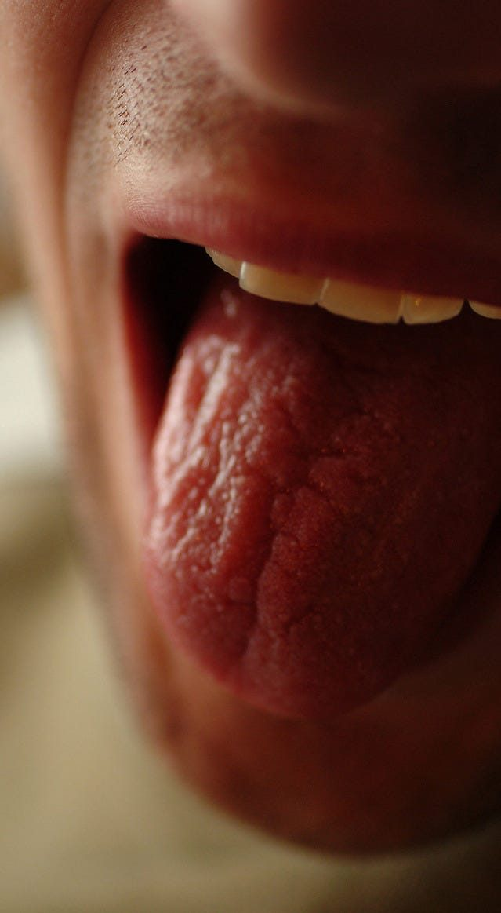

* * *

I heard my dad spew venom
Like poison frogs
Darting from his mouth.
Her voice was shrilly mocked.

When I was little
He wanted me to sing
I sang before I spoke
I felt before I knew

I saw my lover dripping blood
Broken, babbling, and confused
He wants to die he cries. He hurts.
He screams at the top of his lungs

Gobsmacked

I have no silver tongue
I feel the lockjaw swelling
Up my throat
…

Tonguetied

…
It sews my voice up tight.
I must wait ’til morning light
I have no silver tongue

What does it mean when
I find black and blue bruises,
Stamping violence everywhere,
Running farther than my eyes can see?

I could have run, far away
And yet I stay
I see I hear I taste I touch
I feel so much, In silence

No More
