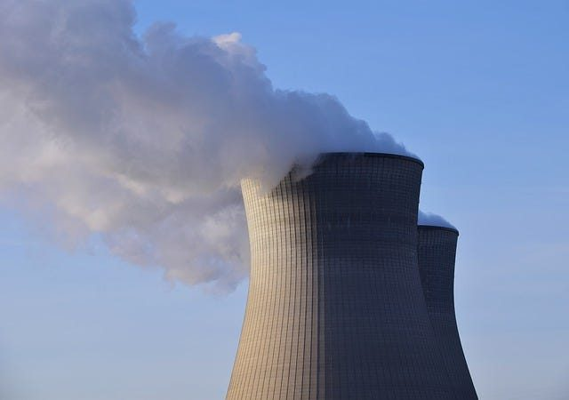

* * *

The nuclear reactor
Blew. Looking back to
See it in the past.
With people bustling
Through the hallways
Generating power
Energy. Feeling
Important and serious
Appreciated for their work
Heat rose
Steam expanded
Failsafes failed
A crack formed, many cracks,
Containment blocks crumbled
And nuclear waste
Could no longer be
Contained. It reacted
In all directions, exploding
The chamber became
Something to run from
Something to hide from
And people died
And the air is toxic
The ground is radioactive
The water poisoned
And death is hidden everywhere
