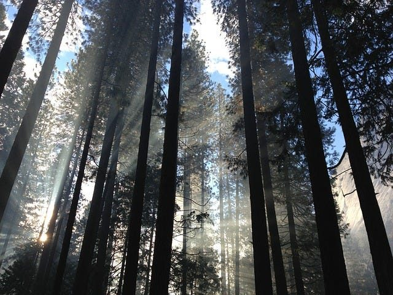

* * *

Sometimes comes in little bits
And is piecemealed out
For those that clearly look 
Sometimes is a blank wall
To be meditated upon
Or hidden so deeply and in
Such a tangled web
That to unravel
Seems to weave it
