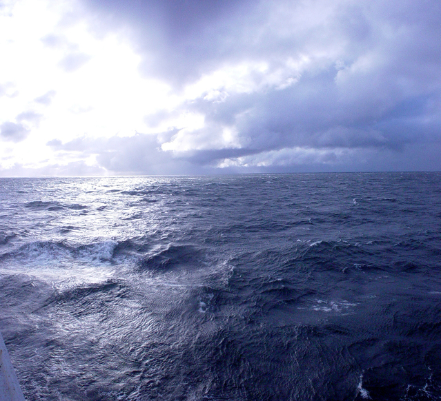

* * *

Feel it all Through
Hidden in the Props

choppy waters
churning waves

tearing through the swells

Faster Faster,
More More More

Feel the Rush,
Excitement. Fear. Anguish. Pain.

Handlebars shaking, swerving
losing grip

Slipping. Falling. Smacking. Rolling.
Dunked and Gulping

Slowly… Slowly… Slowing
Stopped

sculling
treading

far from shore

quiet now
in the center
engines off

still waters

soaking

waiting

floating

clouds

buoyed

Time to Start
Heading
