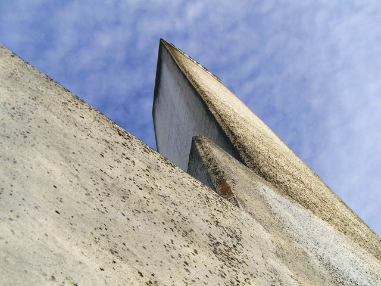

The tower is falling
The ground hollowed out

The tower is falling
Our eyes burn with light

The chalice is filling
Our tears are a deluge

The tower is falling
The deaths go unnumbered

The graal is full
Swallow your pride

The tower is falling
Strengthen your will

We are falling
The Fallen
