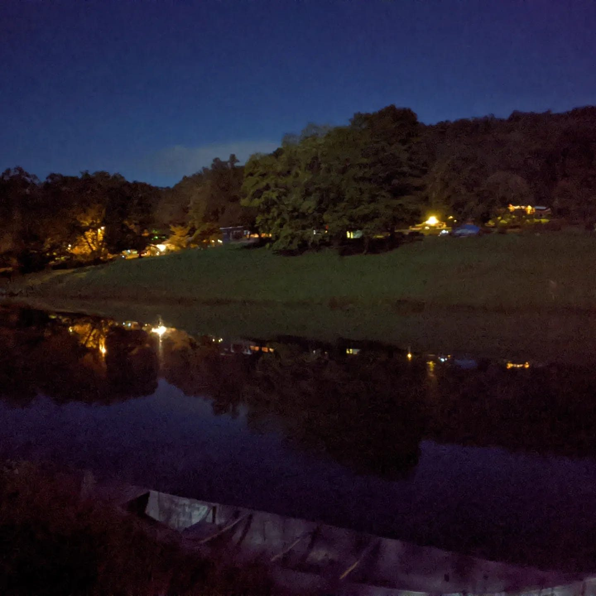

* * *

after some indescribable sense of time
where i might have been invisible
or might have been an Amazonian Wild Thing
who called upon the golden horn of Dionysus and raised high the candy apple thyrsus spear

* * *

i woke up again one morning
far away from home and also home
felt my feet land 
in the soggy soft green grass

* * *

i found myself in West Virginia
as the Sun, Ra-Horakhty, 
started peeking over and through the trees like the green man
in the wild Appalachians

* * *

Horus of the Two Horizons 
riding his battle barge 
emerging victorious from the underworld
in his eternal wrestle with Apophis

* * *

the Aries super moon was setting 
settling in bed with his mistress, 
Aphrodite was restless
dreaming of her return to Tartarus

* * *

All of them
The Old Gods of the Deep Abyss 
The Ancient Ones
were having a conference in the sky

* * *

looking upon listening to speaking from
i shook and shivered, weeping in reverence 
being here now Being alive and embodied 
it feels good, being known like that within the expanse

* * *

we chat a bit, Orion, creator of the gods
the Atman, and I
They were watching 
keeping tabs all this time

* * *

reminding me to trust what happens
as feelings leapt uncontained from the body
Like a live wire sputtering on the ground
someone heard and made sure i wasn’t cold

* * *

I smiled and they left me to my deep moment with the divine
within the borderlands between night and day
grounding me more fully 
as i reached toward the sky

* * *

my feet were wet and my soul was raining
even though the heavens were so clear
the body took over and plunged quick
directly into the cool lake remembering

* * *

leaving my cloak, shed like a skin, on the sand
returning Dmuzi to hell, like Ishtar before her sister in ceremony
the seasons change, the stars fade, the moon sets
and the sun is just the sun in the sky

* * *

*10022023*

* * *

## Hymn To Dionysus

O blessed are they who, happy in heart,
Knows the initiation rites of the gods,
Purifies their life and Joins their soul to the cult,
Dancing on the mountains, with holy purifications
Celebrating the Bacchic rituals.
O blessed are they who dutifully observe
The mysteries of the Great Mother, Kybele.
Shaking high the thyrsus spear
Crowned atop with ivy
This Living Earth flows with milk, 
This Living Earth flows with wine,
This Living Earth flows with the nectar of the bees.
The Bacchic One, graced with the golden horn, calls us nigh.
