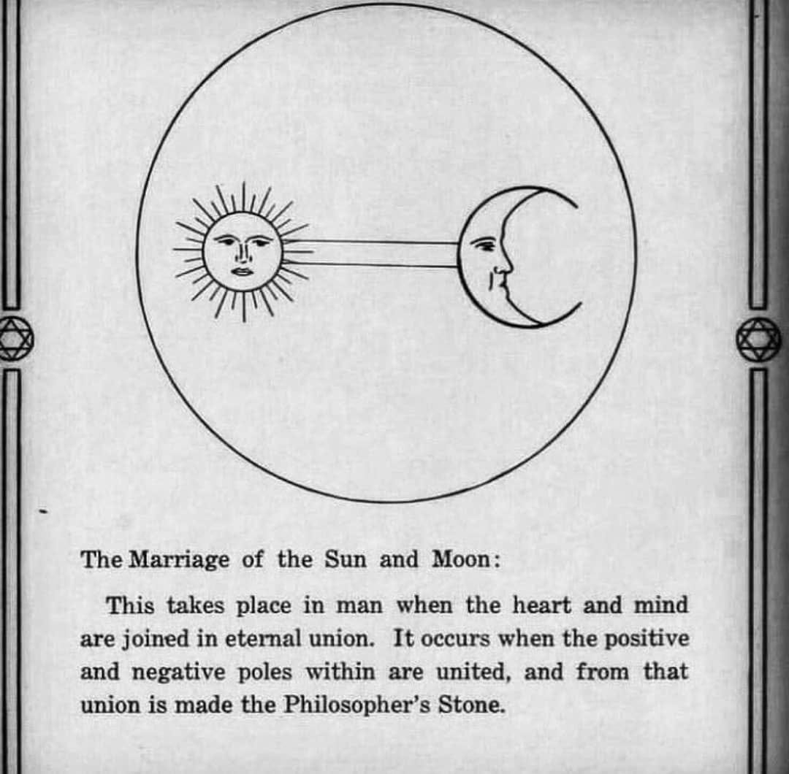
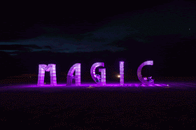

* * *

didnt realize
what id wed
that dark evening
while we can be
heroes playing
in the lamplight
stars flying through
the midsummer night sky
bottomed out dreams
bottled like fireflies
diving into the flames
desert bloooming
boom boom boom
gold-limned lacewing
fluttering sputtering
from a portal door
landing in the dust
of the third city
circled round
ding ding ding
so many
carnival calls
kissing
the lake bed
wind scouring
our crusted canvas
soulfire shot
from our temples
cirrus dragons
floating high above
crowned royal
shining metal magic
burnished fur
in whitehot fire
wading pink into
the silent sunrise
still and slowly
holding ourselves
virgin born inside
a shared vision
singing hummm
run aground
saved by the salt
the earth
quite the lover that

* * *

*202007 -* **Tat Tvam Asi**
[https://www.anoopkumar.com/post/the-mathematics-of-tat-tvam-asi](https://www.anoopkumar.com/post/the-mathematics-of-tat-tvam-asi)

* * *

## enantiodromia

*To flow backward. But this flowing backward can be more than a regression into the personal unconscious, it can be a heartfelt return to workable ancient values, more deeply held ideas. If we understand this stage of the initiation of endurance as a step backward, it must also be considered a step ten leagues down and back into the realm of Wild*

— *Heraclitus, paraphrased by Dr. Clarissa Pinkola Estes*

* * *

“[A Tale of Three Cities” by Jamie Wheal https://link.medium.com/thC3FCgHl6](https://link.medium.com/thC3FCgHl6)
[https://youtu.be/Xzm6YkEw8NU](https://youtu.be/Xzm6YkEw8NU)

* * *

