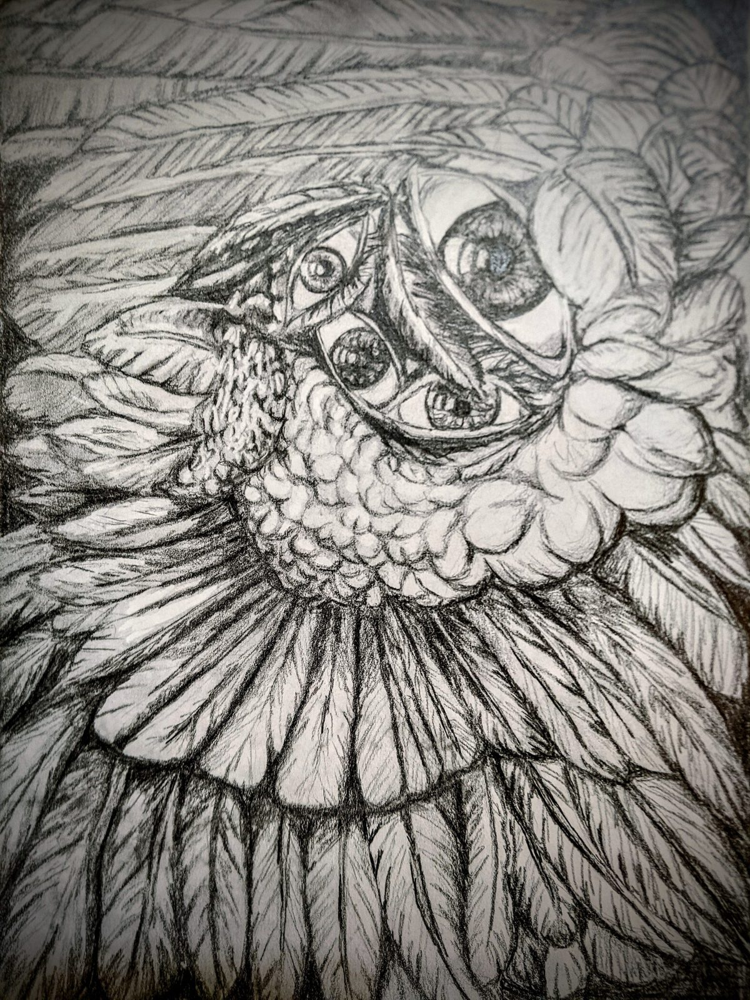

* * *

A mem'ry (*mp)*
A beacon
A star
Rising (*cres < f)*

* * *

'Pon white (*mp)*
Feathered wings
Snow dusted and (*dec >)*
Swaddled soft

* * *

Om shala (*cres < f)*
Home
Om shala (*dec >)*
I am Home (*mp)*

* * *

Coo-ooing like doves (*mp)*
In rafters above

* * *

Osanna (*mf)*
Joy (*dec >)*
Osanna (*dec >)*
I am Joy (*dec > mp)*

* * *

A mem'ry (*mp)*
A beacon
A star
Rising

* * *

Lights up the night (*mp)*
With glowing radiance

* * *

Araphel (*p)*
Night
Araphel
I am Night

* * *

A child (*mp)*
Our children
Our life
Rising

* * *

Spar-ka-ling skies (*mp)*
In their eyes
Lovingly
Held abreast

* * *

Ha’ aha’ a (*f)*
Recognize
Ha a' aah (*dec > mp)*
In our eyes

* * *

A mem'ry (*mp)*
A beacon
A star
Rising

* * *

A dream at its start (*mp)*
A babe's bated cry (*dec >)*
Calling softly to us (*p)*

* * *

Mem’ry calling bright
Finding our way
To the Light

* * *

Calling Light (*mf)*
Gifting Song (*dec >)*
Guiding where we belong (*mp)*

* * *

Shine on (*f)*
Shine on (*dec > mf)*
Shine on (*dec > mp)*
Shine on (*dim e ret p)*

* * *

*202012*
