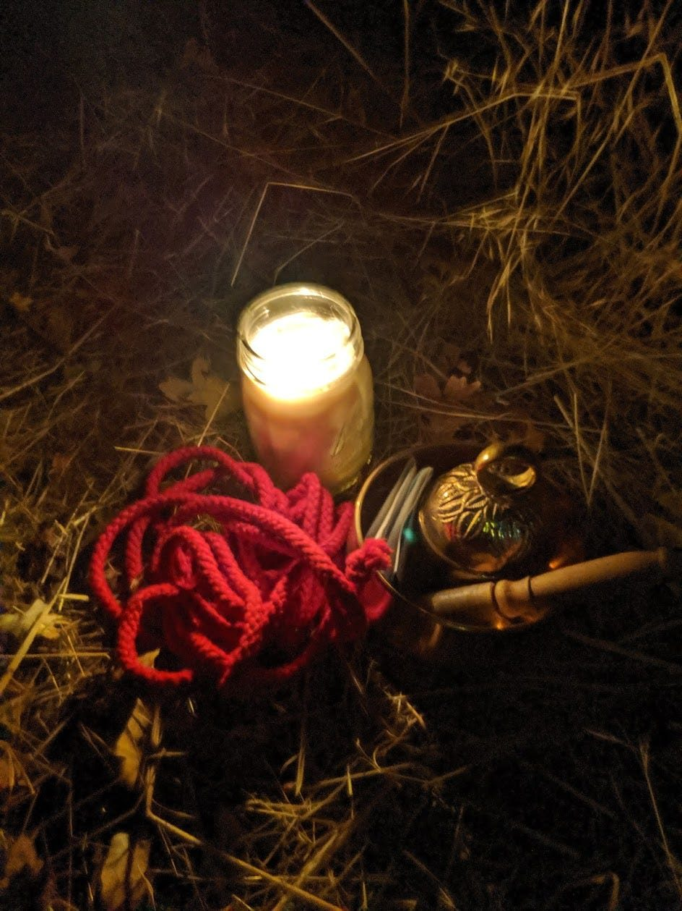

practicing craft

in the dead of night

starts out a star

burns briefly bright

cascades between

fingertips glowing

heavy smoke falls

candles flutter

lit with wonder

sparking awe

humming tunes

as crickets do

writing runes

in worship

of clear light

dreams

unborn babes

future flight

* * *

*08/2020*

