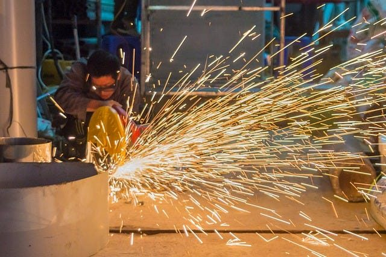

*[https://pixabay.com/en/users/Robert\_z\_Ziemi-3005398/](https://pixabay.com/en/users/Robert_z_Ziemi-3005398/)*

* * *

Light reflects through colored glass bottles

Tingling on the windowsills and walls

Fabric, toys, and old doll parts litter the floor and shelves,

Arduino breadboards full of wires are attached to robotics

That make the dolls dance and the colored lights change

To the booming yaw of speakers siphoning scraps of music and sound

Along with the sewing machine’s whir and chuck

Electric saws cutting wood down the hall, wafting a burned pine smell

That dusts your mouth as you lick your lips and wipe sweat from your brow

A hint of astringent glue permeates as you move closer

The smell grows so strong that you open the paned windows

A chilled blast of wind hits you and creates eddies on the floor

Children’s laughter plays in from outside

Paint glomps as its flung toward wood and canvas

Over a heated discussion among friends trying to decide what to do next

The tile cutter whines through watery mud with an earthy tone

A high pitched squeal of scored and broken glass sets its placement

Sparks fall from the arc welder and bounce off the concrete floor,

Gloves and tongs grasp metal too bright and hot to hold

Next to the forge that burns roaring, rasping gold and orange

Smoke rises from the bright blue welds as the electricity hum-pops

Creating tension in the songs and sights of handiwork and craftship
